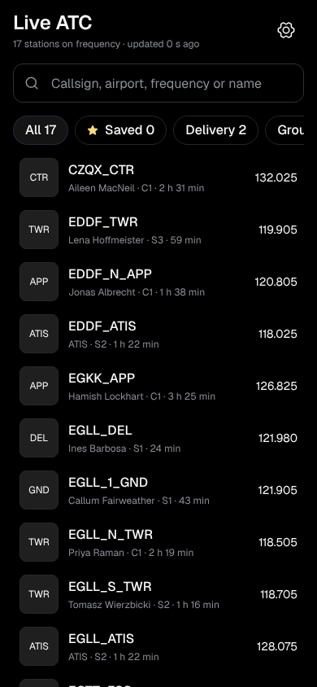
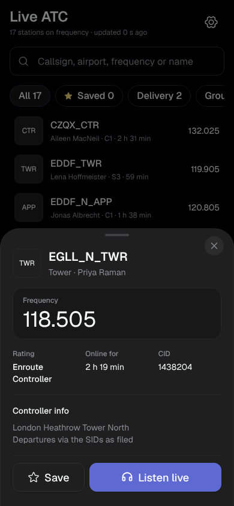
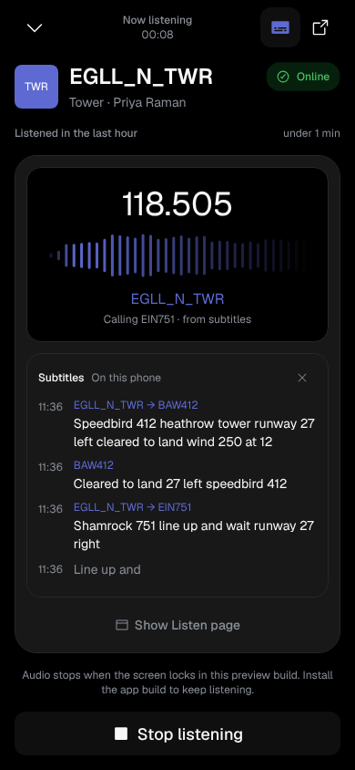
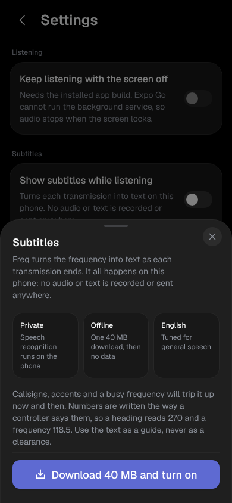

# Freq

Live VATSIM ATC audio on an Android phone. Pick a controller from the live network, listen in, keep listening with the screen off or while you use other apps, and read each transmission as built-in subtitles, transcribed on the phone.

Built with Expo (SDK 58), [PanelUI](https://panelui.dev) components, Geist and Geist Mono, and Phosphor icons.

<p>
  
  
  
  
</p>

<sub>Screenshots from the web design preview with sample stations and sample subtitles. On a phone, the middle panel of the player is the live VATSIM Listen page.</sub>

## Get the app

Download the latest APK from [Releases](https://github.com/Aster-Ker/freq-vatsim/releases/latest) on your Android phone and open it. Android asks once to allow installs from your browser or file manager. It needs Android 8 or later on a 64-bit phone.

### Publishing a release

[`.github/workflows/android-release.yml`](.github/workflows/android-release.yml) builds the APK on GitHub's runners. Push a version tag and it publishes a release with the APK attached:

```bash
git tag v1.0.1 && git push origin v1.0.1
```

You can also run it from the Actions tab (**Android release**, then **Run workflow**) for a test build, which is kept as a downloadable artifact for 14 days.

### Signing key

Without a key of your own, builds are signed with the shared React Native debug key. They install and update normally, but that key is public. To sign with your own key, create one once and keep the file and passwords somewhere safe; Android only accepts an update signed with the same key:

```bash
keytool -genkeypair -v -keystore freq-release.jks -alias freq -keyalg RSA -keysize 4096 -validity 10000
```

Then add four repository secrets under Settings, Secrets and variables, Actions:

| Secret | Value |
| --- | --- |
| `ANDROID_KEYSTORE_BASE64` | output of `base64 -w0 freq-release.jks` |
| `ANDROID_KEYSTORE_PASSWORD` | the keystore password |
| `ANDROID_KEY_ALIAS` | `freq` |
| `ANDROID_KEY_PASSWORD` | the key password (the same as the keystore password unless you set one) |

Switching keys means people uninstall the old build once, so it is best done before you share the first release.

## How it works

| Piece | Source |
| --- | --- |
| Station list | The public VATSIM data feed (`data.vatsim.net/v3/vatsim-data.json`), polled every 30 s while the app is open |
| Audio | **VATSIM Listen** (`listen.vatsim.net/live/{CALLSIGN}`), VATSIM's own listening service, shown in an in-app WebView |
| Background playback | A small local native module (`modules/freq-playback`) that runs a media playback foreground service while a station is playing. It holds a CPU wake lock and a Wi-Fi lock and shows a media notification with Stop |
| Subtitles | Built in. An audio tap injected into the Listen page hands 16 kHz PCM to an on-device recognizer ([Vosk](https://alphacephei.com/vosk/), small English model, downloaded once, about 40 MB) |

Freq does not connect to the voice network itself. VATSIM only lets approved clients join Audio for VATSIM, and Listen is VATSIM's route for people who only want to listen. Listen's rules apply:

* You need a VATSIM account. You sign in inside the player the first time and the WebView keeps the session.
* 15 minutes of listening per hour, and a cap on how many people can listen at once. The player shows a local estimate of the 15 minutes. VATSIM's count is the one that matters.

### Background audio

The WebView that plays Listen is mounted once at the root (`components/player.tsx`) and never unmounted during a session. Minimising the player slides it off screen. `react-native-webview` does not pause on app background, so the audio keeps going as long as Android keeps the process running. The foreground service in `modules/freq-playback` is what keeps it running. Stop in the notification, or pause on the lock screen, ends the session and tells the JS side through an `onStopRequest` event.

### Subtitles

Tap the subtitles button in the player (or use Settings). The first time, Freq downloads the English speech model (about 40 MB) from alphacephei.com into app storage. After that it works offline.

How the audio reaches the recognizer:

1. `lib/audio-tap.ts` is injected into the Listen page before the page's own scripts run. It branches off everything the page plays, whether through Web Audio or an `<audio>` element (including a WebRTC stream), without changing what you hear. It resamples to 16 kHz mono PCM16 and posts quarter second chunks, only while subtitles are on and only while there is sound. If the page plays the same sound both ways, only one copy is forwarded.
2. `components/listen-webview.tsx` passes the chunks to the native module.
3. `CaptionEngine.kt` runs Vosk on one worker thread and sends back a partial line while someone is talking and a final line when they stop.
4. `lib/atc-text.ts` writes numbers the way they are spoken on frequency ("one one eight decimal five" becomes 118.5, "flight level three five zero" becomes FL350).

Lines show in the player, the latest line shows in the mini player, and with background listening on, the notification shows the latest line too, so you can read it from the lock screen. Nothing is recorded and no audio or text leaves the phone. The recognizer only runs while subtitles are on and a station is playing, because it holds about 70 MB of memory.

The small model is general English, not trained on ATC, so callsigns and fast readbacks come out rough at times. The UI says to treat the text as a guide.

## Run it

Background playback and subtitles need a native build, because Expo Go can't load the local module. In Expo Go the app still plays audio, but it stops when the screen locks and subtitles are unavailable.

```bash
npm install
```

On a USB-connected phone or an emulator (needs the Android SDK):

```bash
npx expo run:android
```

Or build an installable APK in the cloud:

```bash
npx eas-cli build --platform android --profile preview
```

Quick look in Expo Go, without background audio:

```bash
npx expo start
```

## Layout

```
app/_layout.tsx            fonts, providers, theme, the player layer above every screen
app/index.tsx              live station list: search, facility filters, saved, detail sheet
app/settings.tsx           background listening, subtitles, appearance, about
components/player.tsx      full player and mini player
components/listen-webview  VATSIM Listen WebView (a .web.tsx placeholder for the web preview)
components/captions-panel  running transcript in the player
components/subtitles-sheet subtitles setup and model download
lib/vatsim.ts              feed parsing, facility mapping, Listen URLs
lib/feed.tsx               polling, paused while the app is in the background
lib/listen.tsx             session state, allowance tally, foreground service control
lib/prefs.tsx              saved stations and settings (AsyncStorage)
lib/audio-tap.ts           script injected into the Listen page to tap its audio
lib/captions.tsx           subtitle state: model download, recognizer lifecycle, lines
lib/atc-text.ts            spoken numbers to ATC notation
lib/caption-demo.ts        sample subtitles for the web design preview only
modules/freq-playback      Kotlin: foreground service and notification, CaptionEngine (Vosk), ModelInstaller
```

## Design notes

Follows PanelUI's tokens and components (Moon theme), with the rules from elayadesign's design skills: Geist with Geist Mono for frequencies and timers, named text styles (`components/type.tsx`), Tailwind's spacing and radius scales, flat dark backgrounds from `#000000` up through `#181818`, `#1F1F1F` and `#272727`, Phosphor icons, a `cubic-bezier(0.22, 1, 0.36, 1)` curve that falls back to a fade under reduced motion, skeleton loading rows, and composed empty and error states.

## Licence

[MIT](LICENSE). Freq is not affiliated with or endorsed by VATSIM. Audio is provided by VATSIM Listen under VATSIM's terms. The Vosk speech model downloaded at runtime is © Alpha Cephei and licensed under Apache 2.0.
